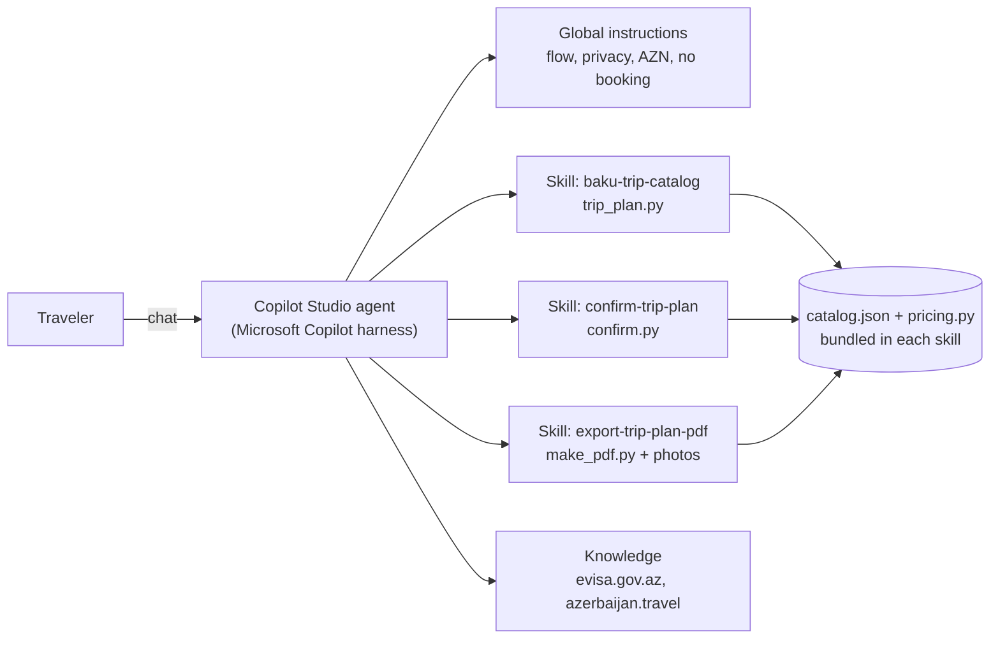

# Baku Travel Agent — Copilot Studio demos from the Baku AI Summit Masterclass

This repository contains **David Lorenzo's demos** from the **Masterclass at the Baku AI Summit on
13 November 2026**. During the session we ran a live hackathon on a topic chosen by the audience:
they proposed ideas, voted, and **"Baku Travel Agent"** won — an assistant that helps visitors
choose a hotel, add activities, see the total price and confirm a trip plan for Baku.

Two presenters built that same idea live, each with a different Microsoft technology:

| Presenter | Approach | Repository |
|---|---|---|
| **David Lorenzo** | **Microsoft Copilot Studio** — a conversational **agent** built spec-first with GitHub Spec Kit and Claude Code, and a **managed app** generated from a prompt on Copilot Managed Runtime with SharePoint data | **This repository** |
| **Lee Stott** | **Microsoft Foundry hosted agents** with a custom React + Python web app ("Caspian Compass"), coded by GitHub Copilot agents | [leestott/AISummitHackBaku](https://github.com/leestott/AISummitHackBaku) |

The audience chose the *idea*, not a winning platform — the point was to compare approaches.
Both repositories include follow-up work after the session (tests, fixes, documentation); they
don't claim everything was finished on stage, and everything in them is a demonstration: no real
bookings or payments.

## What's in this repository

### 1. The Copilot Studio agent (main demo)

A conversational agent built the spec-driven way: **GitHub Spec Kit** for the specification →
plan → tasks flow, **Claude Code** with Microsoft's **Copilot Studio authoring plugin**
(`mcs-assistant`) and the **Power Platform CLI** to write, push, test and publish the agent as
YAML. Start with the [step-by-step guide](#the-guide).

### 2. The managed app (Copilot Managed Runtime)

The same scenario as an **app generated in Copilot Studio from one prompt** — hotels, activities,
travel plan, checkout, confirmation and a "My trips" screen — running on **Copilot Managed
Runtime** with its data in a **SharePoint** site. See [`docs/managed-apps/`](docs/managed-apps/README.md):
what it is, tenant prerequisites, how to enable it, screenshots, and how to build it yourself.

### Lee Stott's demo: Caspian Compass (Microsoft Foundry)

Lee's [AISummitHackBaku](https://github.com/leestott/AISummitHackBaku) repository takes a
pro-code route to the same idea:

- **App**: a React / TypeScript / Vite web app (search, hotel comparison and map, day-by-day
  itinerary, travel checklist, assistant, simulated checkout) served by a **FastAPI** back end
  with **SQLite** demo sessions.
- **Agents**: one **Microsoft Foundry hosted-agent** runtime with three agents — a concierge, an
  itinerary specialist and a travel-facts specialist — that explain and interpret requests but
  never book anything.
- **How it was built**: from a written specification, with **GitHub Copilot coordinating four
  coding agents in parallel** (travel engine, API and booking, web interface, Foundry platform)
  around a shared JSON contract.
- **Design choices it shares with this repo**: deterministic code — not the model — owns prices,
  dates, inventory and booking state; synthetic data (fictional hotels in real districts);
  dated, sourced travel facts; a simulated booking with a published test card, and a
  watermarked PDF itinerary and calendar export.
- **Quality**: Python and web tests, a browser end-to-end journey and a 100-request search
  benchmark.

| | Copilot Studio agent (this repo) | Copilot Studio managed app (this repo) | Foundry hosted agents (Lee's repo) |
|---|---|---|---|
| Experience | Conversation | Screens and forms | Web app with an assistant |
| Built with | Spec Kit + Claude Code + Copilot Studio plugin | One prompt + one follow-up prompt in Copilot Studio | Specification + GitHub Copilot coding agents |
| Logic | Python scripts in agent skills | Generated app logic | FastAPI travel engine |
| Data | Bundled JSON catalog | SharePoint lists | Seeded catalog + SQLite |
| Runs on | Microsoft Copilot harness (Copilot Studio) | Copilot Managed Runtime | Microsoft Foundry + local web/API |
| Code you maintain | YAML + Python | None (generated, read-only) | Full application |

---

## About the Copilot Studio agent

The agent helps travelers plan a trip to Baku, Azerbaijan:

1. asks for dates and number of travelers,
2. shows hotels with photos and **AZN** prices per person per night, and calculates the stay total,
3. offers activities with photos and prices, recalculating the **grand total** after every change,
4. collects the plan holder's name, email and phone, and confirms **only after an explicit yes**,
5. shows the confirmed plan with a reference and exports it as a **PDF**.

All prices and totals are computed by Python scripts inside the agent's skills — never by the
model — and the catalog is fictional sample data with freely licensed Wikimedia Commons photos.

> **Status**: the agent was built, tested (119 unit tests, 17 test-chat conversations) and
> published to a Copilot Studio environment on 2026-11-13. One success criterion — a usability
> check with 5 first-time users (SC-006) — is still open; a ready-to-run kit is in
> [`specs/001-baku-trip-planner/usability/`](specs/001-baku-trip-planner/usability/README.md).

## Architecture



- **No topics, no Power Fx, no connectors.** The agent runs on the agentic-loop harness; the plan
  is carried between turns as a JSON "plan state" that the scripts recompute from the catalog on
  every call, so totals are always exact.
- **Three focused skills** (uploaded packages with `SKILL.md` + Python scripts), two official
  websites for grounded travel answers.

## Repository map

| Path | What's there |
|---|---|
| [`docs/`](docs/) | **The step-by-step guide** — start here |
| [`specs/001-baku-trip-planner/`](specs/001-baku-trip-planner/) | Spec Kit artifacts: spec, plan, research, data model, contracts, tasks, test results, usability kit |
| [`.specify/`](.specify/) | Spec Kit scaffolding and the project [constitution](.specify/memory/constitution.md) |
| [`skills-src/`](skills-src/) | Source of the three skills; `_shared/` holds the single catalog and pricing module |
| [`agent/`](agent/) | Reference snapshot of the Copilot Studio workspace (YAML) as pulled by PAC — tied to the original environment, see [docs/06](docs/06-deploy-the-agent.md) |
| [`tools/`](tools/) | `validate_agent.py`, `sync_shared.py`, `stage_skill.py`, `fetch_photos.py`, `export_sharepoint_seed.py` |
| [`managed-app/`](managed-app/sharepoint-seed/README.md) | SharePoint seed data (Hotels, Activities CSV) for the Copilot Managed Runtime app |
| [`tests/`](tests/) | 119 pytest unit tests for pricing, scripts, PDF and the YAML validator |

## The guide

| # | Doc | You'll learn |
|---|---|---|
| 1 | [Prerequisites](docs/01-prerequisites.md) | Everything you need before starting — accounts, roles, tools |
| 2 | [Licensing and Copilot Credits](docs/02-licensing-and-credits.md) | Capacity packs vs pay-as-you-go, what consumes credits, what this demo cost |
| 3 | [Tenant and environment setup](docs/03-tenant-and-environment.md) | Dataverse environment, roles, generative AI settings, capacity |
| 4 | [Developer machine setup](docs/04-dev-machine-setup.md) | Install Python, .NET, PAC CLI, Node, uv, Spec Kit, Claude Code and plugins |
| 5 | [The Spec Kit workflow we followed](docs/05-spec-kit-workflow.md) | Constitution → specify → clarify → plan → tasks → analyze → implement, with the prompts |
| 6 | [Deploy the agent to your environment](docs/06-deploy-the-agent.md) | Fast path: create your agent, import the skills, add knowledge, push |
| 7 | [Testing](docs/07-testing.md) | Unit tests, test-chat scenarios, safety tests, PDF check, usability |
| 8 | [Publish and share](docs/08-publish-and-share.md) | Publishing, sharing, Teams/Microsoft 365 Copilot channels |
| 9 | [Troubleshooting and lessons learned](docs/09-troubleshooting.md) | Every gotcha we hit and how to avoid it |

**Managed app section**: [what it is](docs/managed-apps/01-what-is-it.md) ·
[tenant prerequisites](docs/managed-apps/02-tenant-prerequisites.md) ·
[enable it in a fresh tenant](docs/managed-apps/03-enable-in-a-fresh-tenant.md) ·
[the Baku Travel app](docs/managed-apps/04-baku-travel-app.md) ·
[build it yourself](docs/managed-apps/05-build-it-yourself.md)

## Quick check (no cloud needed)

```bash
python3 -m venv .venv && .venv/bin/pip install -r requirements-dev.txt
```

```bash
.venv/bin/python -m pytest -q
```

## License

Code and documentation: [MIT](LICENSE). Lee Stott's demo lives in its own repository under its own terms. Catalog photos come from Wikimedia Commons under their own
Creative Commons licenses — see [ATTRIBUTION.md](ATTRIBUTION.md). Hotel names and prices are
fictional sample data. Not affiliated with or endorsed by Microsoft, GitHub, Anthropic or the
Republic of Azerbaijan.
