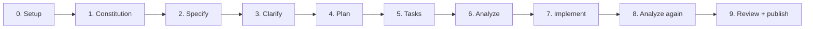

# 5. The Spec Kit workflow we followed

How the Copilot Studio agent from the Baku AI Summit Masterclass (13 November 2026) was built
from an empty folder, in order, with the prompts used. Everything ran in
**Claude Code** with the Spec Kit skills and the Copilot Studio plugin installed
([doc 4](04-dev-machine-setup.md)). Each step's output is in
[`specs/001-baku-trip-planner/`](../specs/001-baku-trip-planner/).



## 0. Setup

In an empty folder:

```bash
specify init --here --force --non-interactive --integration claude
```

This adds `.specify/` (templates, scripts, constitution) and `.claude/skills/speckit-*`.
Then initialize Git — the constitution later requires commits and a reviewable diff:

```bash
git init -b main
```

Opening prompt we used: *"I will create a travel agent in Copilot Studio for traveling to Baku.
I want to use Speckit, and use Copilot Studio authoring plugin to create the agent. Ensure every
skill gets installed before we start."*

## 1. Constitution — `/speckit-constitution`

Sets non-negotiable project principles that every later step is checked against. Prompt (abridged):

```text
/speckit-constitution Project: a Microsoft Copilot Studio travel agent that helps users plan trips
to Baku, built with Spec Kit and the Copilot Studio authoring plugin (modern agentic-loop YAML).
Principles: (1) spec-first; (2) accuracy and grounding — official sources, say when unknown;
(3) traveler safety and privacy — no booking/payment without explicit confirmation, no passport
or card data; (4) Copilot Studio native — generative orchestration, YAML in the repo, validate
before push, review before publish; (5) testable conversations incl. negative tests;
(6) simplicity and incremental delivery. Amendments need a version bump.
```

Result: [constitution v1.0.0](../.specify/memory/constitution.md), later amended to **1.1.0**
(holder contact details allowed at confirmation; "confirming is not booking") and **1.1.1**
(environment described generically for this public repo).

## 2. Specify — `/speckit-specify`

The feature request, verbatim:

```text
/speckit-specify I want to Create a travel agent in Copilot Studio for helping users traveling to
Baku. Agent should first offer some hotel options to select. Every hotel must have a price per
person and per day, when you add the hotel, it must calculate the total price of the stay and show
it in the plan. After selecting the hotel, it should offer some activities to choose. For
activities, we want to show price, description, name, photos (you can use stock photos). When we
add hotel or activity to the plan, you must recalculate the grand total. It should ask if we want
to add more activities or continue to confirmation step. In confirmation step it should ask for
holder data, and finally, confirm the plan. Finally, it should show all the plan information and
an option to export it in PDF. Create skills necesaries to architect a good agent.
```

Result: [spec.md](../specs/001-baku-trip-planner/spec.md) — 4 prioritized user stories (hotel,
activities, confirmation, PDF), 24 functional requirements, 7 success criteria, edge cases and
example conversations, plus a quality checklist.

## 3. Clarify

The spec came with three open questions, answered as:

| Question | Answer |
|---|---|
| What does "confirm the plan" mean? | A confirmed **plan/quote** with a reference — no real reservation or payment |
| Currency? | **Azerbaijani manat (AZN)** |
| Which holder data? | **Full name, email, phone** — nothing else |

Holder contact data went beyond the constitution's "minimum trip context", so we **amended the
constitution** (v1.1.0) before planning.

## 4. Plan — `/speckit-plan`

Prompt:

```text
/speckit-plan Target: Microsoft Copilot Studio agent using the modern generative orchestration
(agentic loop), authored as YAML with the Copilot Studio authoring plugin (mcs-assistant) and
PAC CLI, deployed to our environment. Design the agent's skills (well-architected), the catalog for
hotels and activities (sample data, stock photos, AZN prices), exact total calculation, cards for
options and the plan, the confirmation flow, and PDF export.
```

Key design decisions ([research.md](../specs/001-baku-trip-planner/research.md)):

- **No topics, variables or Power Fx** exist in this agent model → the plan travels between turns
  as a JSON **plan state**; scripts **recompute every price from the catalog** on each call.
- **Python scripts inside skills** do all arithmetic (`decimal`, half-up, AZN) — the model never
  calculates.
- **Three focused skills** instead of one big one: `baku-trip-catalog`, `confirm-trip-plan`,
  `export-trip-plan-pdf`; global flow and safety rules live in the **instructions**.
- **Catalog as a bundled JSON file**, not a knowledge source (listing exact prices isn't a search
  problem). Fictional hotel names; real activity types; Wikimedia Commons photos.
- **Markdown with images** for options (Adaptive Cards need topics, which this model doesn't have).
- **PDF with reportlab** in the sandbox; photos **bundled** because the sandbox has no network.
- Two **official websites** as knowledge for visa/practical questions.

Also produced: [data-model.md](../specs/001-baku-trip-planner/data-model.md),
[contracts/](../specs/001-baku-trip-planner/contracts/) (script CLI, chat rendering, PDF layout,
plan-state JSON schema, agent components) and
[quickstart.md](../specs/001-baku-trip-planner/quickstart.md) (test scenarios).

## 5. Tasks — `/speckit-tasks`

[tasks.md](../specs/001-baku-trip-planner/tasks.md): 49 dependency-ordered tasks in 7 phases —
setup, foundation (agent, validator, spike, catalog, pricing), one phase per user story (tests
first), polish (knowledge, regression, usability, review, publish).

## 6. Analyze — `/speckit-analyze` (before coding)

A read-only consistency check across constitution, spec, plan and tasks. It found **two
constitution gaps** we then fixed in the tasks: no Git commits for the required review, and no
YAML validation before each push (→ `tools/validate_agent.py`). Plus: repeat safety tests 3× (AI
replies vary), add a full end-to-end scenario, find photos via the Commons API.

## 7. Implement — `/speckit-implement`

Phase by phase, tests first. Highlights:

1. **Spike first.** A throwaway skill proved in the real runtime that scripts run (Python 3.12),
   bundled images are readable, Markdown images render, and a PDF is offered for download — before
   building anything on those assumptions.
2. **Foundation**: catalog with 11 photos, `pricing.py` (29 tests), sync tool so all three skill
   packages share one catalog and pricing module.
3. **User stories**: each script was written test-first, then its `SKILL.md`, then imported, pushed
   and tested in the **Copilot Studio test chat** (driven in Chrome by Claude).
4. **Testing** found and fixed real issues: line breaks in chat cards, the agent rewording prompts,
   and the agent advising users to book the (fictional) hotels directly.

Details of every step and command: [doc 6](06-deploy-the-agent.md) and [doc 7](07-testing.md).
Lessons learned: [doc 9](09-troubleshooting.md).

## 8. Analyze again (after coding)

Found: the early publish done by `pac copilot init` (recorded as a constitution exception), the
built-in web search (instructions tightened to official sources), a response-time goal that wasn't
realistic (revised), and documentation drift. All fixed before review.

## 9. Review and publish

Review of the Git diff since the baseline commit, unit tests, YAML validation and all test-chat
results → explicit approval → `pac copilot publish` ([doc 8](08-publish-and-share.md)).

## Reuse this method for your own agent

1. `specify init --here --integration claude` in an empty repo; `git init`.
2. `/speckit-constitution` with your principles (privacy, grounding, testing, Copilot Studio rules).
3. `/speckit-specify` with your feature in plain language; answer the clarifications.
4. `/speckit-plan` naming the target (Copilot Studio CLI agent, mcs-assistant, PAC CLI).
5. `/speckit-tasks`, then `/speckit-analyze` and fix what it finds.
6. `/speckit-implement` — start with a runtime spike; push with validation; test in the test chat.
7. `/speckit-analyze` again, review the diff, publish.
