# 4. The Baku Travel app (Baku AI Summit)

In the **Masterclass at the Baku AI Summit on 13 November 2026**, the audience voted for a
"Baku Travel Agent" as the live hackathon topic. Besides the agent in this repo, David Lorenzo
built it as an **app** generated in Copilot Studio from a natural-language prompt, with its data in a
new **SharePoint** site. Then we extended it with a second prompt. This page records what we
built; [5. Build it yourself](05-build-it-yourself.md) shows how to reproduce it.

## The prompts

**1 — Create the app**

```text
Create a travel agent app for helping users traveling to Baku. I need a section to choose hotels,
find activities. Then we want to create a travel plan, where I can add the hotel and several
activities.

Every hotel must have a price per person and per day, when you add the hotel, it must calculate the
total price of the stay and show it in the plan.

For activities, we want to show price, description, name, photos (you can use stock photos).

When we add hotel or activity to the plan, you must recalculate the grand total.

Then a checkout page where we can add holder data and confirm the plan.

Finally, a confirmation page that shows all plan detail with all the information.

Use a new sharepoint site to hold all the information, add test information you can find on the
internet, eberything about Baku.
```

**2 — Add a feature**

```text
add a new screen to list and view the current trips
```

## What the app does

The generated app has three areas in its top bar — **Plan**, **Checkout** and **My trips** — plus
a badge with the number of items in the plan and the running total.

### Plan: hotels and activities

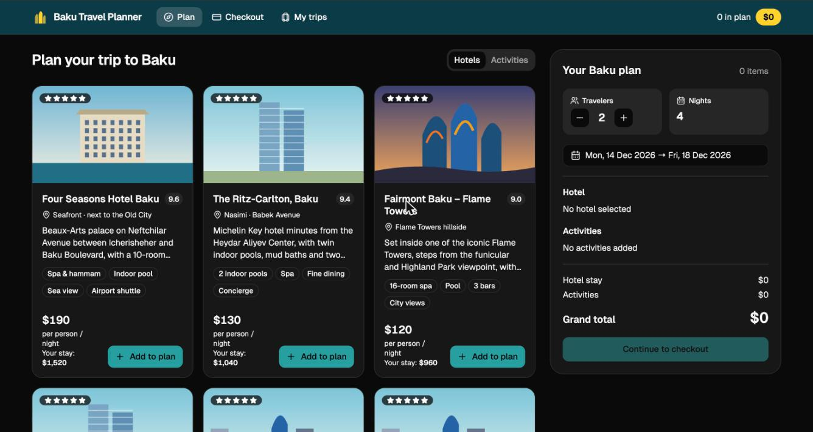

- **Hotels** tab: cards with an illustration, star rating, review score, neighborhood, description,
  amenity tags, **price per person per night** and "Your stay" (the stay total for the current
  travelers and nights), and **Add to plan**.
- **Your Baku plan** panel (right): number of **travelers** (−/+), **nights**, the date range, the
  selected hotel and activities, hotel stay, activities and **grand total**, and **Continue to
  checkout**.

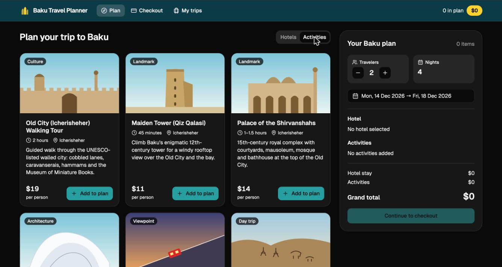

- **Activities** tab: cards with a category (Culture, Landmark, Architecture, Viewpoint, Day
  trip…), duration, area, description and **price per person**.

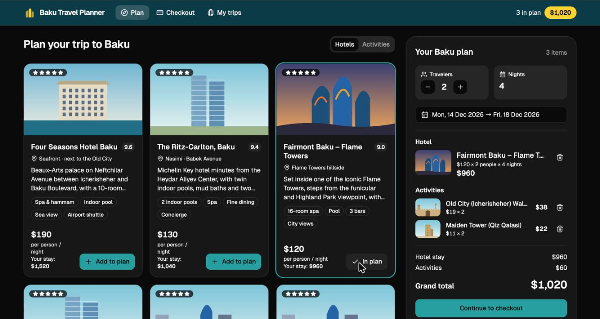

Adding a hotel and two activities recalculates everything: Fairmont Baku – Flame Towers
$120 × 2 people × 4 nights = **$960**, Old City Walking Tour $19 × 2 = $38, Maiden Tower
$11 × 2 = $22 → grand total **$1,020**. Each line can be removed with the bin icon.

### Checkout

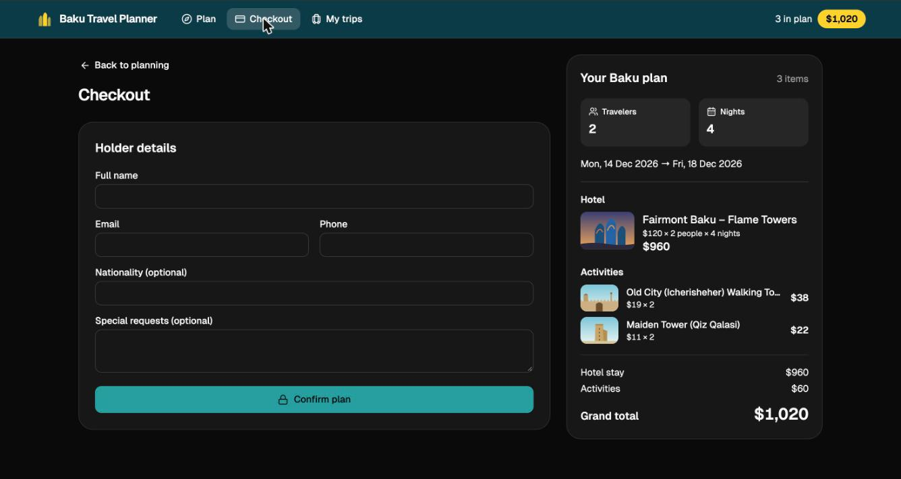

Holder details — **full name, email, phone**, plus optional **nationality** and **special
requests** — next to a summary of the plan, and **Confirm plan**.

### My trips *(second prompt)*

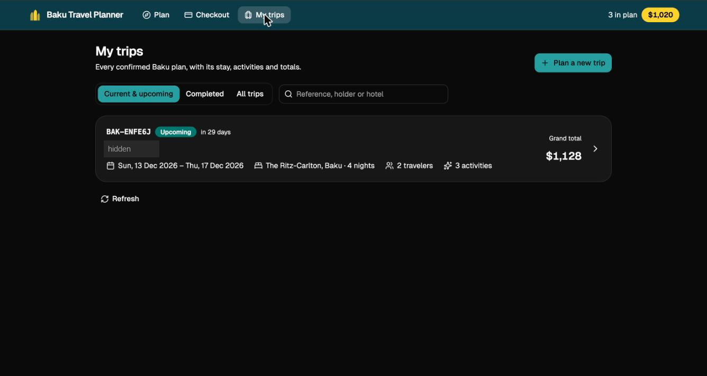

Every confirmed plan with its reference (e.g. `BAK-ENFE6J`), status (Upcoming, "in 29 days"),
holder, dates, hotel, nights, travelers, number of activities and grand total. Filters
**Current & upcoming / Completed / All trips**, search by reference, holder or hotel, **Refresh**
and **Plan a new trip**.

### Trip details / confirmation

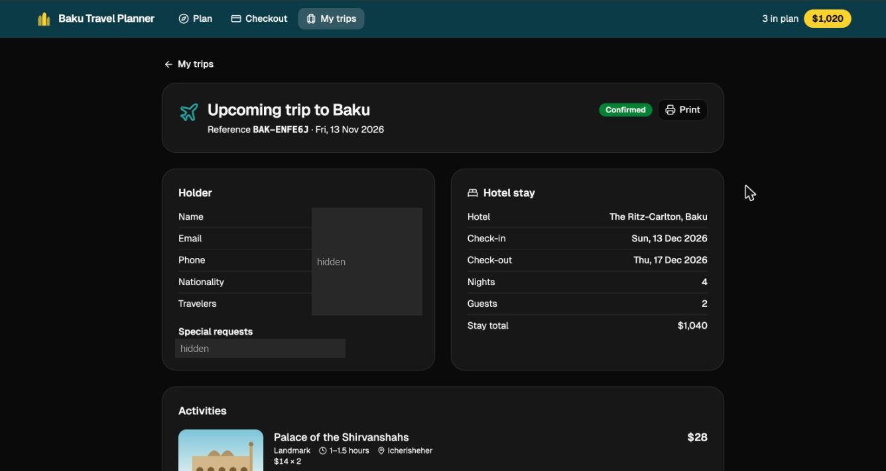

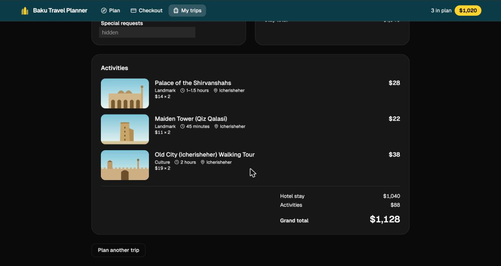

The confirmed trip: reference and date, **Confirmed** status and **Print**; holder; hotel stay
(check-in, check-out, nights, guests, stay total); each activity with price × travelers; hotel
stay, activities and grand total (The Ritz-Carlton $130 × 2 × 4 = $1,040 + activities $88 =
**$1,128**).

> Holder details in the screenshots are hidden. Screenshots taken 14 Nov 2026 from the app's
> preview URL.

### Notes on the generated content

- Prices are in **US dollars** and the hotels are **real Baku hotels** (Four Seasons, Ritz-Carlton,
  Fairmont, JW Marriott, Hilton, InterContinental…) with **generated test prices and ratings** —
  not real rates. The prompt asked for "test information you can find on the internet".
- Card images are **generated illustrations**, not photos.
- Reference numbers use the format `BAK-XXXXXX`.

## Where the data lives

The generator **created a new SharePoint site** — "Baku Travel Planner 319c09" — and three
lists, filled with test data about Baku (11 hotels, 12 activities). The `319c09` suffix is a
random id the generator adds to the site and list names.

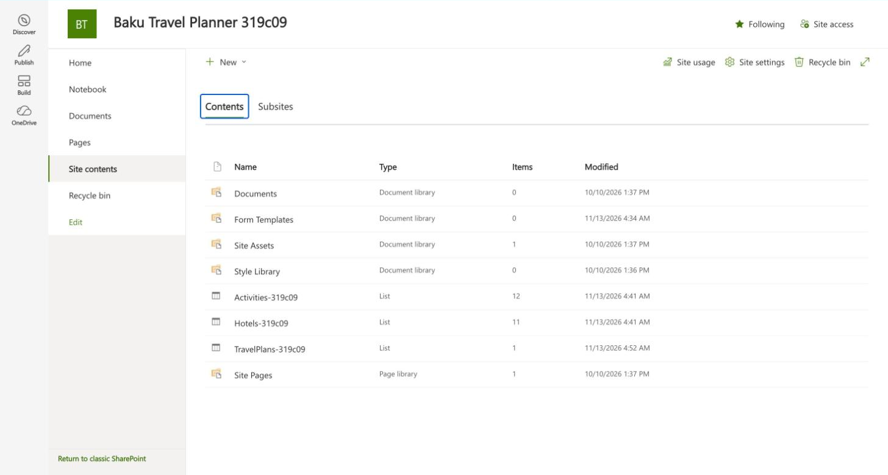

| List | Holds | Columns (type) |
|---|---|---|
| **Hotels-319c09** | Hotel catalog | Title (text), District (text), Stars (number), PricePerPersonNight (currency), GuestRating (number), Description (multi-line), Amenities (text), ImageKey (text) |
| **Activities-319c09** | Activity catalog | Title (text), Category (text), Description (multi-line), Price (currency), Duration (text), Location (text), ImageKey (text) |
| **TravelPlans-319c09** | One row per confirmed trip | Title (text — the reference), HolderName, HolderEmail, HolderPhone, Nationality (text), Travelers (number), CheckIn, CheckOut (date/time), HotelName (text), Nights (number), HotelTotal (currency), ActivitiesDetail (multi-line), ActivitiesTotal (currency), GrandTotal (currency), Status (text), Notes (multi-line) |

Things to notice:

- **No lookups and no separate trip-items list**: a trip stores the hotel by name and its
  activities as text in `ActivitiesDetail`, along with the totals calculated at checkout — a
  snapshot of the plan, so later catalog price changes don't alter confirmed trips.
- **Images are keys, not files**: `ImageKey` (e.g. `seafront`, `tower`, `flame`, `oldcity`,
  `maiden`) selects one of the illustrations drawn by the app.
- **Holder data is stored in SharePoint** — limit site permissions accordingly (see
  [Build it yourself](05-build-it-yourself.md#5-publish-and-share)).

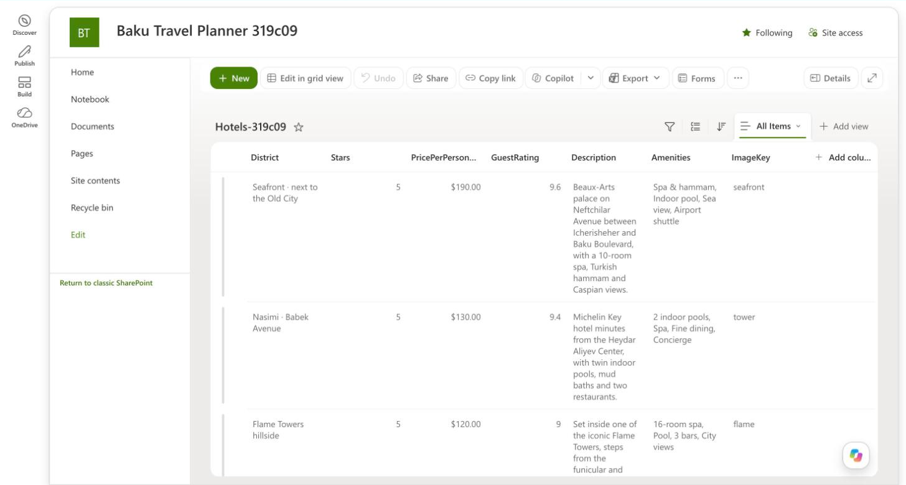

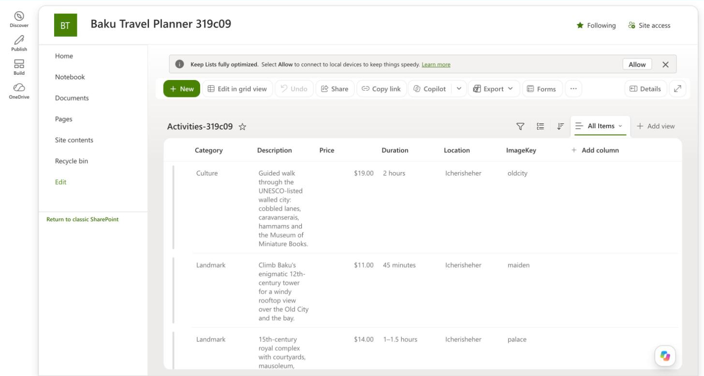

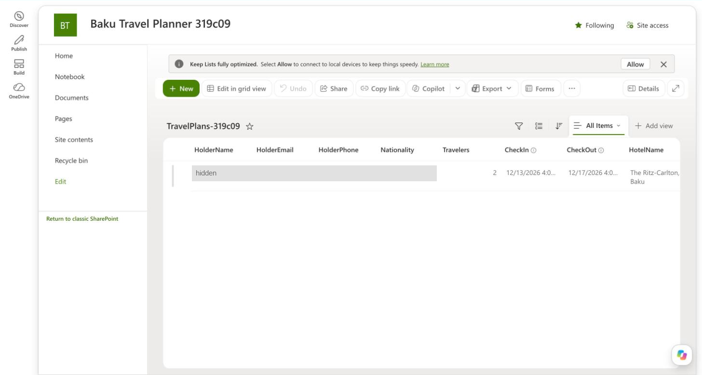

## Agent vs app — same scenario, two approaches

| | Agent (this repo's main demo) | App (Baku AI Summit) |
|---|---|---|
| Built with | Spec Kit + Claude Code + PAC CLI, as YAML and Python | One prompt in Copilot Studio, then iterate with prompts |
| User experience | Conversation | Screens and buttons |
| Totals | Python scripts in skills (exact, tested) | App logic generated from the prompt (verified on screen) |
| Data | Bundled JSON catalog (fictional hotels, AZN); nothing stored | 3 SharePoint lists: Hotels, Activities, TravelPlans; real hotel names, generated USD test prices |
| Output | Confirmed plan + PDF | Confirmation screen + saved trips |
| Time to first version | About a day with full spec, tests and review | Minutes |
| Best for | Guided, conversational flows with strict rules | Data-entry and browsing experiences over business data |
